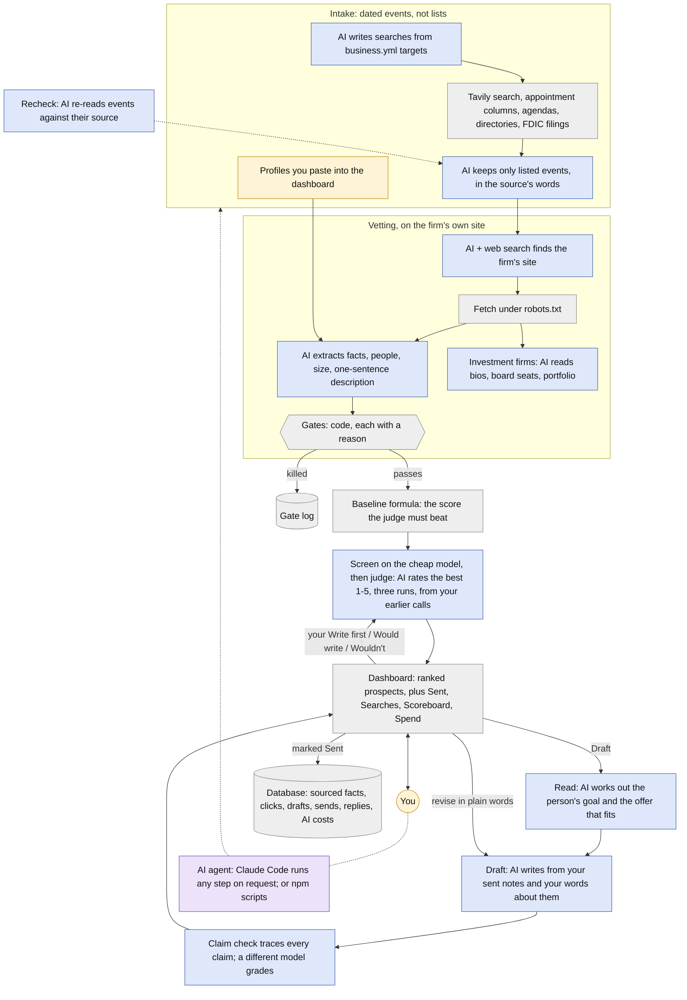

# How it works

[← README](../README.md) · [Measurement](measurement.md) · [Guardrails](guardrails.md) · [Setup](setup.md)

Blue: a single LLM call (Claude) with a structured output. Purple: an AI agent that uses tools. Grey: deterministic code, search and storage. Amber: you.

## Intake: dated events, not lists

A prospect enters because something dated happened. Six sources:

- **Measured searches,** written by a model from the operator's targets and events,
  approved once, run weekly, retired after two empty runs ([Measurement](measurement.md)).
  Events found on the open web (posts, talks, podcasts, job postings) are searched
  across the whole web; a search can instead be limited to press-release wires.
- **Appointment columns** in trade press, for newly named data and AI leaders.
- **Conference agendas** from the organiser's own pages, keeping only speakers the page
  names, with their sessions. New conferences are found where example prospects speak
  and by searches from the targets.
- **The operator's pastes** of a profile they read themselves, stored with a provenance
  marker so they are never mistaken for something retrieved. Extraction checks the
  current employer against the firm on file, and records the board seats, advisory
  roles, investments and founder roles held besides the job, because those can be
  where the buyer is when the person's own seat buys nothing.
- **Firm lists** from rankings and directories, for a target limited to one kind of
  firm that publishes no events. A firm is admitted only if its own site makes it the
  target's kind, it resembles an example prospect's firm, no gate kills it, and it names
  someone in one of the target's seats, who alone is kept. Every firm turned away keeps
  its reason.
- **The bank register.** Banks of the targeted size announce almost nothing, so they
  are listed by size from the FDIC's quarterly filings, which also supply the dated
  reason: a cost of earning a dollar in the worst quarter of US banks the same size, a
  year running, or assets that just crossed $10bn. Each fact cites its filing.

`npm run recheck` retracts any stored event its source's words do not support.

## Vetting and gates

**Vetting** finds the firm's site with Claude and Anthropic's web search tool (a couple
of searches at most, costed like Tavily's), then reads it under `robots.txt`: what it
does in one plain sentence, how big it is, who is named. A page redirecting to a different business is
refused. A browser is used only where `robots.txt` permits the page and a plain fetch
cannot read it, and the run records when ([Guardrails](guardrails.md)).

**For an investment firm** (`npm run bios`), bios are read for committees and board
seats, and the portfolio page for holdings. Each current portfolio company enters the
book linked to the partner on its board, so a note to the partner can name it, and its
card shows who owns it and who sits on its board. A team list served at every bio
address is detected and discarded.

**Gates are code, not judgment.** Too small, too big, already staffed for the work, a
marketplace or expert network, a recent note to the same firm: each is a function, and a
killed firm stays in the log with its reason. A staffing firm placing contractors is a
separate kind, and passes.

## The judge

The judge rates each person 1 to 5 on how compelling a note would be, three times,
keeping the median and showing a spread of two or more. It has no scoring rules, only
the operator's past calls on the most similar people with their reasons, and it cites
evidence by id. It also rates who decides (owns the budget, influences, or
neither) and records which target the person fits. A **screen** first asks the same
question once on the cheap model, and only people it rates 2 or more are judged in
full. The judge is MiniMax M3 through OpenRouter, on the host it was measured on, and a
weighted formula runs beside it as the baseline it must beat
([Measurement](measurement.md)).

## The dashboard

Static HTML from the database, opened from disk or through a form server
(`npm run inbox`, 127.0.0.1, started by hand) that records clicks, pastes and sends.

- **All prospects:** everyone not yet written to, in the judge's order.
- **Ready:** the short list, rated 3 and up.
- **To paste:** promising people whose profile the operator has not read yet.
- **Funnel, Sent, Searches, Scoreboard, Spend, Gate log, Inputs.**

Each prospect is a **card**, and the working pages filter cards in place by target,
offer, geography, the operator's call, who decides, and whether a profile is pasted.

### What a card shows

- **Rating, person, title, firm** in one sentence with a link, and **the reason to write**.
- **Need, owner, value:** a named need, whether this person owns or only influences the
  budget, the size of the work, days since the event, and the suggested channel. *Why,
  in full* opens the judge's reasoning, each point tied to its evidence.
- **Events and facts,** dated, in the source's own words, linked to the source; facts
  from a pasted profile are marked as the operator's.
- **Reach by:** a real address, else a message if connected, a connection request if
  they know the operator or are a strong card at 2nd degree, a paid InMail for a strong
  card at 3rd degree, rarely on LinkedIn, or with a dated event under two weeks old, a
  guessed address marked as a guess. Addresses have a copy button; channels tried are
  skipped.
- **A profile search link** the operator clicks, and a box to paste what they read.
- **The operator's call:** *Write first*, *Would write* or *Wouldn't*, with a reason.
- **The note:** latest draft, channel and recipient, a character count where the channel
  has a limit, *Draft again* with plain-word instructions, and *Sent as …* once gone.
- **Status:** *In flight* once sent, *Cooling off* if a colleague was written to recently.

The main page opens on **Accepted, not yet written to**: everyone who accepted a
connection request in the last fourteen days with nothing since, with the latest unsent
draft. Each gets one note; silence is not chased.
*In flight* shows everyone written to, whatever their seat.

## The read and the draft

**The read** works out the person's goal, what is in the way, and which offer would
help, once a profile is pasted for someone the judge says to write to (a later paste
reads again). The goal is **stated** (they or the firm said it), **inferred** (at least two dated facts agree, among them why the
person is in the seat now) or **role only**. An inferred goal steers the note but is
never asserted in it.

**The drafter** first sets a storyline, shown atop the draft's notes: the goal, a lede
from something the person recently said or did, the bridge to the operator's work, and
the live offer that is the logical next step. An offer may carry variants in
`business.yml` for a particular dated event, with their own pitch and tracked link, used
when the lede is that event. A person's board seats and advisory roles are used, and
anything the operator has said about the person outranks the model's inference. A
"would write" verdict on someone at a firm the gates killed as a buyer lets the note
be drafted; do-not-contact and holds still refuse. For someone at an investor, each
offer is judged against the portfolio companies they serve, not the fund's own staff.
Before the read and the drafter use a talk or a quote, its page is fetched again, and a
record whose page no longer names the person is removed.

**The examples are the operator's latest sent notes** on the same kind of channel, up
to fifteen (email, InMail and LinkedIn messages share a pool; connection notes learn
only from connection notes), each with its inputs, the drafter's reasoning, the
revise requests and the text sent; with too few, it falls back to `prompts/voice.md`. Old notes have
retired wording (`you.superseded_wording` in `business.yml`) updated, long revise
requests or ones quoting a prospect's page are withheld, and retired phrases listed in
the voice file are flagged on the card. The Scoreboard
compares example sets ([Measurement](measurement.md)).

**The first message after an accepted connection** is one plain note: why the operator
asked to connect, what he does for someone in that seat, and an open door. No tactic,
offer, hook, referral or meeting ask, and no restating of the accepted note; after it,
only the operator's own posts and comments. These learn only from their own kind.

**A comment on a fresh post.** A pasted profile's Activity section is checked by date
alone, at no cost, for the person's own post from the last week. Only then does a model
judge whether a buyer's post invites a comment the operator can add to, and draft two of
one or two plain sentences: one memorable result, no jargon, pitch, link or offer, within
the never-claim screen, learned from past posted comments. **Worth a comment**, atop the
Ready and main pages, lists them for a week; the operator comments by hand and records
the outcome.

Every note proposes custom work where packaged software does not reach: the
unstructured material around a team's systems and the routine calls made from it,
drafted for a person to approve.

**Checking and grading.** A separate call traces every factual claim to the evidence on
file, including a recorded acceptance, and flags any it cannot. A **grader**, a
different model, asks six questions: claims on file, no recital of the reader's own
facts, no never-claim, no broken channel rule, every reference lands, and, advisory,
whether the approach fits (not their own job, the right ask for a buyer or a router, at
their level, not what a product already does, a lede that is theirs). Flags show on the
card with the words that failed. Revisions are in plain words; every version is kept,
**Sent** records the exact text and channel, and replies link to the note that drew them.

**The channel test.** Every person rated 4+ with an address at the firm's own domain
(published, or guessed from a published pattern) is assigned email or LinkedIn
alternately, so channel is not confounded with who publishes an address. The operator
still chooses; what was sent is counted, and the Scoreboard compares reply rates on
sends at least fourteen days old, bounces apart from silence. Personal addresses do
not qualify.

## Steps and their commands

Each step runs on its own, by command or by asking Claude Code; the daily run chains
the routine ones.

| Step | Command | What it does | Model tier |
|---|---|---|---|
| Searches | `npm run queries` | propose, run, measure and retire searches | default / cheap |
| Appointments | `npm run moves` | new data and AI leaders from trade columns | cheap |
| Agendas | `npm run events` | speakers and sessions from conference sites | default |
| Conferences | `npm run conferences` | find new conferences, then read their agendas into the book | cheap |
| Firm lists | `npm run firms` | a target's firms from rankings and directories, each checked on its own site before it is kept | cheap |
| Banks | `npm run lead -- banks`, `npm run lead -- bank-efficiency` | every insured bank in an asset band from the FDIC register; then, from each quarter's call reports, banks whose efficiency ratio is in the worst quarter of national peers their size, or whose assets crossed $10bn | none |
| Vet | `npm run lead -- vet` | the firm's own site, then the gates | cheap |
| Addresses | `npm run lead -- addresses` | a published address on the firm's own pages (then at most one press search), and the pattern it implies for everyone there, kept as a guess | none |
| Bios | `npm run bios` | bios, board seats, portfolios of investment firms | cheap |
| Gates | `npm run gate` | deterministic disqualifiers | none |
| Screen | `npm run judge -- --screen` | the judge's question, once, to decide who is judged in full | cheap |
| Judge | `npm run judge` | 1-5 rating from past decisions | judge |
| Bio | `npm run bio` | a person's official bio from their organisation's own site or a conference site, never LinkedIn, so fewer profiles are pasted by hand | default |
| Research | `npm run research` | a third-party summary of a person from across the web (news, interviews, podcasts, directories), every fact with its page, kept only if that page names the person; LinkedIn is blocked at the search tool; the people found are judged again | default |
| Read | `npm run read` | what the person is trying to do | default |
| Draft | `npm run draft` | the note, then a claim check and a grade | most capable |
| Grade | `npm run grade` | a draft graded on six questions by a model other than the one that wrote it | grader |
| Comment | `npm run comment` | on paste: two draft comments on the person's own post from the last week, when one is worth it | most capable |
| Recheck | `npm run recheck` | stored events re-read against their source | cheap |
| Replay | `npm run replay` | redraft recent sent notes with each example set, judged blind against what was sent; stores no draft | most capable + grader |
| Describe | `npm run describe` | each firm in one plain sentence | cheap |
| Dashboard | `npm run dash` | static HTML from SQLite | none |
| Daily | `npm run daily` | the routine run, once a weekday: searches and agendas weekly, vet, gate, rank, screen, judge, research, addresses, dashboard; no drafts | as above |

Tiers map to models in `config/runtime.yml` ([Setup](setup.md)): the judge is MiniMax
M3 through OpenRouter, the rest are Claude. The daily run's Claude calls use the
Batches API at half price.

**Prompts live in versioned files** under `prompts/`, each noting why it last changed,
and every rating and draft records which one produced it.

**Storage** is one SQLite file, gitignored: firms, people, evidence with provenance,
dated events, gate results, judgments, verdicts, drafts, sends, replies, searches and
their yields, holdings and board seats, and the cost ledger.

## Limitations

- Reply rates are small numbers; nothing here is statistically settled.
- The judge is nondeterministic. It runs three times and reports the spread; a
  single run is never treated as a measurement.
- Some firm sites defeat bio reading; the step detects and discards those rather
  than guessing.
- Guessed email addresses can bounce or fail silently; the page labels them.
- Coverage is what the sources publish. A firm that announces nothing is invisible.
